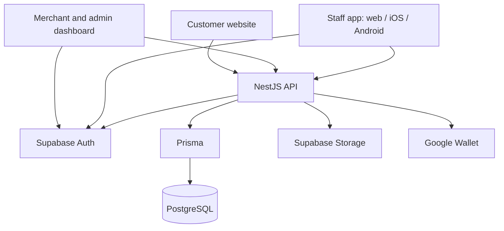

<p align="center">
  
</p>

<h1 align="center">Turn everyday visits into lasting loyalty.</h1>

<p align="center">
  Digital loyalty cards, meaningful rewards, and the tools to bring customers back.<br />
  Built for coffee shops and hospitality businesses in Egypt.
</p>

<p align="center">
  <a href="#what-is-dvote">About</a> ·
  <a href="#the-platform">The platform</a> ·
  <a href="#features">Features</a> ·
  <a href="#getting-started">Getting started</a> ·
  <a href="#documentation">Documentation</a>
</p>

---

## What is dvote?

**dvote helps merchants turn a purchase into a reason to return.** It brings a merchant's storefront, loyalty programme, customer relationships, and day-to-day operations into one platform.

Customers tap an NFC tag or scan a QR code, open the merchant's page, and get a digital loyalty card without installing an app. At the counter, staff scan the card to add purchase points or redeem a reward. Merchants set their own earning rules, design their cards, manage branches and teams, and understand what brings customers back.

Each merchant has its own programme. A customer's points work across that merchant's branches and stay separate from every other merchant's balance.

### From first tap to next reward

1. **Discover and join.** Open the merchant's storefront from a link, NFC tag, or printed QR. Enter a name and Egyptian mobile number, with age confirmation, to create or recover a card. The current public flow requires no email, password, or OTP.
2. **Keep the card handy.** View it on the web or save it to Google Wallet when the integration is configured.
3. **Earn on a purchase.** Staff scan the card and enter the receipt total. The API calculates the points and records the transaction.
4. **Enjoy a reward.** Staff scan the card, select an available reward, and confirm redemption. The server checks the balance and deducts the cost.
5. **Come back for more.** The balance updates, while merchants can use customer segments, Wallet messages, and insights to support repeat visits.

For example, a merchant offering **1 point for every EGP 10 spent** awards **9 points on an EGP 95 purchase**. Redeeming a 300-point coffee from a 1,000-point balance leaves 700 points for the next visit.

## The platform

| Application | Who it serves | What it does |
| --- | --- | --- |
| **Merchant dashboard** | Merchant admins and branch managers | Storefronts, loyalty cards, rewards, branches, teams, customers, activity, insights, and Broadcast, subject to role permissions. |
| **Platform admin dashboard** | The dvote team | Merchant onboarding, platform customers, statistics, support, audit history, and merchant-scoped operations. Shares the dashboard codebase. |
| **Customer website** | Customers | Merchant storefronts, joining and recovering cards, viewing points and rewards, Wallet links, and feedback. |
| **Staff app** | Cashiers, branch managers, and merchant admins | Collect and redeem flows with camera scanning or manual code entry. One Expo codebase for web, iOS, and Android. |
| **Coming soon page** | Public visitors | A standalone branded holding page prepared for `dvote.co`. |
| **API** | All active applications | Business rules, identity checks, tenant boundaries, points, rewards, storage, reporting, and Wallet integrations. |

**Current direction:** customer web and Wallet cards are the primary customer experience. The earlier Expo customer app is archived at the Git tag `customer-app-v1` and is outside the active setup below.

## Features

### Loyalty that belongs to the merchant

- Spend-based earning rules with purchase minimums and optional point caps.
- Branded card design, previews, version publishing, and card lifecycle controls.
- Reward catalogues with photos, point costs, optional retail values, and English/Arabic descriptions.
- Branch-level sold-out controls and redemption history.
- A dashboard Till and dedicated staff app for collecting points and giving rewards.

### A storefront customers can open anywhere

- Shareable merchant pages with branding, menu images, rewards, branch details, and maps.
- Card creation and recovery using a normalized Egyptian mobile number.
- QR and NFC entry links that retain source and branch attribution.
- Google Wallet pass creation and balance/branding sync after changes.
- Customer-to-merchant feedback from the public website.
- English and Arabic experiences, including right-to-left layouts.

### Tools for running and growing the business

- Merchant setup checklist, operational summaries, and attention items.
- Branch management, locations, photos, and pause/resume controls.
- Team invitations and role-based merchant/branch access.
- Customer lists, built-in and custom segments, and CSV export.
- Ledger activity, redemption reports, reward performance, and customer patterns.
- Broadcast messages with audience previews, draft autosave and recovery, scheduling, and repeating campaigns.
- Nearby reminder settings for selected geolocated branches; Google Wallet controls whether and when reminders appear.
- Platform-wide listings, merchant workspaces, and admin action logs.
- Responsive dashboard layouts with light/dark themes and English/Arabic localization.

### Status and integration boundaries

| Area | Current state |
| --- | --- |
| Google Wallet | Implemented; pass issuance, updates, and messages need issuer credentials and server configuration. Provider acceptance does not prove device delivery or an open. |
| Apple Wallet | Planned. UI previews and entry points exist, but Apple passes and notification delivery are not implemented. |
| Broadcast campaigns | Implemented in source. The project handoff records migration `30_broadcast_campaigns` as local-only; shared deployment requires that migration before enabling the updated page. |
| Generated API client | Reserved in `packages/api-client`; not generated yet. Active apps currently maintain their own API types. |
| Native customer app | Archived at `customer-app-v1`; the customer journey now starts on the web. |
| Public holding page | Prepared in `apps/coming-soon`; publication at `dvote.co` is pending hosting/domain access in the latest handoff. |

Deployment status can differ from source availability. Check the latest notes in [DVOTE_BRIEF.md](DVOTE_BRIEF.md) before releasing new features.

## Architecture



The API owns business data and balance changes. Clients use Supabase for authentication where required and call the API for application data. They do not query the database or upload directly to Storage.

### Stack

| Layer | Technology |
| --- | --- |
| Dashboard | React 19, TypeScript, Vite, Tailwind CSS v4, shadcn/ui + Radix, TanStack Query, React Router, Recharts, Solar icons |
| Customer website | React 19, TypeScript, Vite, Tailwind CSS v4, React Router |
| Staff app | React Native, Expo SDK 57, Expo Router, Expo Camera |
| Backend | NestJS 12, TypeScript, Prisma 7, PostgreSQL |
| Managed services | Supabase Auth, Postgres, and Storage; Google Wallet |
| Verification | Jest, Supertest, PostgreSQL integration tests, and Playwright |

### Transaction guarantees

- **The server decides points.** Money calculations use integer minor units, with points rounded down.
- **Every balance change has a ledger entry.** The append-only ledger and cached card balance update in one database transaction.
- **Retries do not award points twice.** Collect and redeem operations use idempotency keys and transactional checks.
- **Merchant boundaries are enforced.** Identity and role determine tenant/branch scope; points never move between merchants.
- **QR types have different lifetimes.** Saved Wallet cards use reusable, merchant-scoped card QRs. The original app flow uses expiring, single-use QRs. Both are validated by the API.
- **Redemption is checked again at confirmation.** Balance, merchant, branch, reward availability, and expected price are validated before points are deducted.

## Repository structure

```text
dvote/
├── apps/
│   ├── api/                 # NestJS API, Prisma schema/migrations, integration tests
│   ├── dashboard/           # Merchant and platform admin dashboard
│   ├── web/                 # Customer storefront, joining, cards, and feedback
│   ├── staff/               # Expo staff scanner: web, iOS, and Android
│   ├── coming-soon/         # Static holding page and dvote logo
│   └── ui-tests/            # Playwright checks with mocked API/auth
├── packages/
│   └── api-client/          # Placeholder for a generated OpenAPI client
├── database/               # SQL schema, development seed, and access lockdown
├── docs/                   # Original specification, plans, and email templates
├── DVOTE_BRIEF.md           # Product direction, decisions, and current handoff
├── AGENTS.md               # Repository guidance for Codex
└── package.json            # Convenience scripts for individual applications
```

Applications have their own dependencies, lockfiles, and environment files. This repository does not currently use npm workspaces; a root install does not install every app.

## Getting started

### Prerequisites

- **Node.js 24** and npm, matching the API container runtime.
- A configured **Supabase project** for authentication, PostgreSQL, and image storage.
- A database with the repository's migrations applied.
- A separate **local PostgreSQL database** for API integration tests.
- Optional: Expo Go for staff app development on a phone, and a Google Wallet issuer account for Wallet features.

### 1. Install the applications

From the repository root:

```bash
npm run api:install
npm run dashboard:install
npm run web:install
npm run staff:install
```

### 2. Configure the environment

```bash
cp apps/api/.env.example apps/api/.env
cp apps/dashboard/.env.example apps/dashboard/.env
cp apps/web/.env.example apps/web/.env
cp apps/staff/.env.example apps/staff/.env
```

Fill in each file using its example as a reference:

| Application | Configuration |
| --- | --- |
| API | `DATABASE_URL`, `SUPABASE_URL`, and server-only `SUPABASE_SECRET_KEY` for invitations and storage. Set `TEST_DATABASE_URL` to a separate local test database. |
| Dashboard | `VITE_API_URL`, `VITE_WEB_URL`, `VITE_SUPABASE_URL`, and `VITE_SUPABASE_PUBLISHABLE_KEY`. |
| Customer website | `VITE_API_URL`. |
| Staff | `EXPO_PUBLIC_API_URL`, `EXPO_PUBLIC_SUPABASE_URL`, and `EXPO_PUBLIC_SUPABASE_PUBLISHABLE_KEY`. |

For all three browser clients, set the API's allowed origins:

```dotenv
CORS_ORIGINS=http://localhost:5173,http://localhost:5174,http://localhost:8081
```

Keep `.env` files, service-account keys, database credentials, and signing keys out of Git. Only public values belong in `VITE_*` and `EXPO_PUBLIC_*` variables.

### 3. Prepare the database and access

From `apps/api`, apply migrations to your intended development database:

```bash
cd apps/api
npx prisma migrate deploy --config prisma7.config.ts
```

This command changes the database selected by `DATABASE_URL`; verify that target before running it. Prepare the separate local test database with the same migrations before integration testing.

The SQL schema reference is [database/dvote_schema.sql](database/dvote_schema.sql), with a sample merchant in [database/dvote_seed_joy_corner.sql](database/dvote_seed_joy_corner.sql). Keep Supabase's Data API locked down using [database/supabase_lockdown.sql](database/supabase_lockdown.sql), including after migrations add tables.

From the repository root, configure Storage and bootstrap a platform admin when needed:

```bash
npm run storage:setup
npm run admin:create -- --name "Your Name" --email "you@example.com" --password "<password>"
```

The dashboard guides platform admins through authenticator-based MFA. Merchant and staff accounts are invitation-based. Configure `STAFF_INVITE_REDIRECT_URL` and Supabase's allowed redirect URLs for the dashboard's `/set-password` page.

### 4. Start the apps

Run each command in its own terminal from the repository root:

| Command | Application | Local address |
| --- | --- | --- |
| `npm run api:dev` | API | `http://localhost:3000` |
| `npm run dashboard:dev` | Merchant and admin dashboard | `http://localhost:5173` |
| `npm run web:dev` | Customer website | `http://localhost:5174` |
| `npm run staff:web` | Staff web app | `http://localhost:8081` |
| `npm run staff:start` | Staff app via Expo | Expo development session |

Check database connectivity at [API health](http://localhost:3000/api/health). In development, explore [Swagger UI](http://localhost:3000/api/docs) or the [OpenAPI JSON](http://localhost:3000/api/docs-json). Swagger is disabled in production.

Phone-browser camera scanning requires HTTPS when deployed. For native device development, see the [staff app guide](apps/staff/README.md).

## Development and verification

Run these commands from the repository root as appropriate to the change:

| Task | Command |
| --- | --- |
| API unit tests | `npm run api:test` |
| API integration tests | `npm run api:test:e2e` |
| API lint | `npm run api:lint` |
| API build | `npm run api:build` |
| Dashboard typecheck / build | `npm --prefix apps/dashboard run typecheck` / `npm --prefix apps/dashboard run build` |
| Customer website typecheck / build | `npm --prefix apps/web run typecheck` / `npm --prefix apps/web run build` |
| Staff typecheck | `npm --prefix apps/staff run typecheck` |
| Install browser test tooling | `npm run ui:install` |
| Responsive browser tests | `npm run ui:test` |
| Browser test report | `npm --prefix apps/ui-tests run report` |
| Database backup | `npm run db:backup` |

API integration tests write and clean up data, require suitable local database permissions, and refuse non-local database hosts. The responsive Playwright suite uses mocked services and covers dashboard/customer pages, multiple roles, dialogs, phone-to-wide-screen layouts, and Arabic RTL. See [apps/ui-tests/README.md](apps/ui-tests/README.md).

Before contributing, read [AGENTS.md](AGENTS.md) and the latest [project handoff](DVOTE_BRIEF.md). Keep user-facing copy localized, use the existing design tokens and shared components, preserve tenant boundaries and ledger guarantees, and update documentation when behaviour changes.

## Deployment

- **API:** build the [Dockerfile](apps/api/Dockerfile) with `apps/api` as the build context. Supply environment variables through the host; migrate the intended database as a separate release step.
- **Dashboard and customer website:** each Vite app produces its own `dist/` directory. Supply public build-time variables, configure SPA route fallback, and allow the deployed origins in API CORS.
- **Staff app:** supports web and native targets; use the app's Expo tooling and public API configuration for the chosen target.
- **Holding page:** publish only `index.html` and `logo.svg` from [apps/coming-soon](apps/coming-soon/README.md). It needs no build step or backend.
- **Wallet:** configure the Google issuer, service-account credentials, a stable `WALLET_TOKEN_SECRET`, and the correct public customer-site URL (`PUBLIC_WEB_URL`). Credentials stay on the server.

The selected public domain is **`dvote.co`**. Some existing examples still reference the earlier `dvote.app` plan; configure real deployment URLs explicitly.

## Documentation

| Resource | Purpose |
| --- | --- |
| [Project brief and handoff](DVOTE_BRIEF.md) | Product direction, decisions, implementation notes, and deployment status. |
| [Codex repository guidance](AGENTS.md) | Technical conventions and business invariants. |
| [Additional project context](CLAUDE.md) | Detailed implementation and integration notes. |
| [Database schema](database/dvote_schema.sql) | SQL schema reference; incremental changes live in `apps/api/prisma/migrations`. |
| [Original product specification](docs/Coffee_Loyalty_Platform_Documentation.pdf) | Original v2 specification; some customer-app flows have since changed. |
| [Dashboard guide](apps/dashboard/README.md) | Dashboard development and configuration. |
| [Customer website guide](apps/web/README.md) | Public-site routes and development setup. |
| [Staff app guide](apps/staff/README.md) | Scanner workflows, device setup, and verification. |
| [Browser test guide](apps/ui-tests/README.md) | Responsive checks, mocked fixtures, and reports. |
| [Email templates](docs/email-templates/README.md) | Supabase invitation and password-reset email setup. |
| [API client placeholder](packages/api-client/README.md) | Planned generated TypeScript client. |

Older app guides and the original specification may describe previous flows. Use the current source and the latest project brief to resolve status differences.
